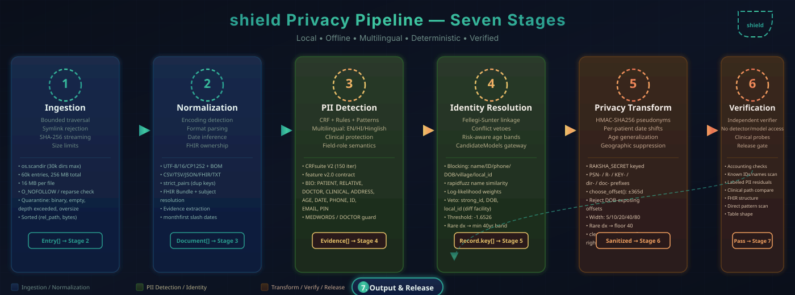

# shield

**Team:** DOTENV  
**Challenge:** Secret Wards — Track 3

> A local, offline privacy firewall for synthetic clinical records. Multilingual PII detection, conservative cross-record identity resolution, secret-keyed pseudonymization, and independent output verification — all without hosted AI services.

---

## Table of Contents

1. [Project Overview](#1-project-overview)
2. [Key Capabilities](#2-key-capabilities)
3. [System Architecture](#3-system-architecture)
4. [End-to-End Processing Workflow](#4-end-to-end-processing-workflow)
5. [Supported Input Formats](#5-supported-input-formats)
6. [Technical Approach](#6-technical-approach)
7. [Dataset Preparation](#7-dataset-preparation)
8. [Trained Models](#8-trained-models)
9. [Unique Technical Differentiators](#9-unique-technical-differentiators)
10. [Technology Stack](#10-technology-stack)
11. [Website Interface](#11-website-interface)
12. [Privacy and Security](#12-privacy-and-security)
13. [Performance and Evaluation](#13-performance-and-evaluation)
14. [Installation and Prerequisites](#14-installation-and-prerequisites)
15. [CLI Execution](#15-cli-execution)
16. [Running the Website](#16-running-the-website)
17. [Output Structure](#17-output-structure)
18. [Repository Structure](#18-repository-structure)
19. [Reproducibility and Validation](#19-reproducibility-and-validation)
20. [Limitations](#20-limitations)
21. [Team](#21-team)

---

## 1. Project Overview

### The Problem

Clinical datasets contain direct identifiers (names, phone numbers, government IDs), quasi-identifiers (age, location, dates), and sensitive clinical information (diagnoses, medications, lab values). Simple text masking fails because:

- **Context matters**: "Patient Name: Rohan" is PII; "Patient Temperature: 38.5" is clinical data. The label determines the treatment.
- **Identity is fragmented**: One patient appears across CSV, JSON, FHIR bundles, and multilingual notes with varying spellings, scripts, and alias formats.
- **Clinical utility must be preserved**: Redacting a diagnosis or medication dose destroys the data's medical value.
- **Re-identification risk compounds**: Age band + district + rare diagnosis can uniquely identify a patient even without direct identifiers.

### How shield Addresses This

shield processes synthetic hospital records entirely offline through a seven-stage pipeline:

1. **Ingestion** — Bounded, symlink-safe directory traversal with encoding detection (UTF-8, UTF-16, CP1252).
2. **Normalization** — Unicode NFKC normalization, format-specific parsing (CSV/TSV/JSON/FHIR/text), date-format inference.
3. **PII Detection** — Hybrid classical CRF sequence tagging + structured-field recognition + contextual rules + pattern matching, with multilingual (English, Hindi, Hinglish) support and clinical-context protection.
4. **Identity Resolution** — Conservative Fellegi-Sunter-style linkage with candidate generation, conflict vetoes, calibrated thresholds, and risk-aware age-band widening for rare diagnoses.
5. **Privacy Transformation** — HMAC-based pseudonymization keyed to `RAKSHA_SECRET`, patient-specific date shifts, age generalization, geographic suppression, and clinical-value preservation.
6. **Independent Verification** — A separate conservative verifier checks for residual identifiers, clinical preservation, output consistency, and patient-reference integrity.
7. **Output & Release** — Sanitized files, `report.json`, `records.jsonl`; website adds a release-approval gate requiring model availability and zero verification findings.

Both the organizer CLI (`main.py`) and the interactive website (React + FastAPI) share the same `sheild.engine` core, ensuring identical processing semantics.

---

## 2. Key Capabilities

| Capability | Implementation |
|------------|----------------|
| **Offline clinical de-identification** | CPU-only, no network calls during processing; `HF_HUB_OFFLINE=1`, `TRANSFORMERS_OFFLINE=1` |
| **Multilingual PII detection** | English, Hindi (Devanagari), Hinglish (Latin-script Hindi); Unicode NFKC normalization, script-aware tokenization |
| **Structured & unstructured processing** | CSV, TSV, JSON (incl. nested arrays), FHIR R4 Bundles, plain text, nested directories |
| **Hybrid trained-model + rule detection** | CRFsuite sequence tagger (V2, 150 iterations) + semantic field-role classification + contextual rules + regex patterns |
| **Cross-record patient linkage** | Candidate blocking on name/ID/phone/DOB/village; rapidfuzz name similarity; Fellegi-Sunter log-likelihood weights; hard conflict vetoes (strong ID, DOB, local ID); facility collision checks |
| **Secret-keyed pseudonymization** | HMAC-SHA256 with `RAKSHA_SECRET`; stable pseudonyms per patient per secret; different secrets → different pseudonyms |
| **Patient-consistent date transformation** | Per-patient secret-derived offset (−365..+365 days); rejects offsets that would expose original DOBs |
| **Quasi-identifier generalization** | Age bands (5/10/20/40/80 years) with distinct-profile support target; rare diagnoses widen to ≥40-year minimum; geographic suppression below district |
| **Clinical information preservation** | Clinical-field allowlist (diagnosis, medicine, dosage, lab values, vitals, LOINC, procedures); path-level verification; doctor-name protection |
| **Independent residual verification** | Separate verifier (`sheild.verify`) scans for known identifiers, known names, labeled PII, clinical probes, direct patterns, FHIR structure |
| **Unsupported/malformed quarantine** | Binary content, encoding errors, invalid tables, duplicate keys/paths, FHIR ownership failures → quarantined in `report.json` |
| **Deterministic output** | Same input + same secret → byte-identical `sanitized/` and `records.jsonl` |
| **Interactive privacy website** | React 19 + Vite 7 SPA served by FastAPI; same-origin; ZIP upload; 7-stage progress; findings panel; release gate |
| **Verified release controls** | Website withholds release unless: model loaded + contract valid + zero verification findings |
| **Privacy-safe findings panel** | Expandable detailed findings (file, locator, category, reason, action) without exposing raw PII in UI |
| **Research data exploration** | Identity registry, pseudonym counts, file preview, artifact download (archive.zip, report.json, records.jsonl) |
| **Downloadable sanitized outputs** | Archive ZIP + individual file preview (table/text) + full artifact access |

Every capability above is verified against the current source code in `sheild/engine.py`, `sheild/verify.py`, `backend/app.py`, and `frontend/src/pages/`.

---

## 3. System Architecture

```mermaid
flowchart TB
    subgraph CLI["Organizer CLI Path"]
        M[main.py] --> DE[directory_entries]
        DE --> RP[run_pipeline]
    end

    subgraph WEB["Website Path"]
        UI[React SPA<br/>frontend/dist] --> FA[FastAPI<br/>backend/app.py]
        FA --> UP["/api/run/upload"]
        UP --> RP
    end

    subgraph CORE["Shared Privacy Engine (sheild.engine)"]
        RP --> ING[Ingestion &<br/>Normalization]
        ING --> PARSE["parse()<br/>CSV/TSV/JSON/FHIR/TXT"]
        PARSE --> EVD["Evidence Extraction<br/>field_role + text_evidence"]
        EVD --> DET["PII Detection<br/>CRF + Rules + Patterns"]
        DET --> LINK["Identity Resolution<br/>Linker.run()"]
        LINK --> SHIFT["Date Shift<br/>Preparation"]
        SHIFT --> TRANS["Privacy Transformation<br/>Engine.clean() / clean_text()"]
        TRANS --> REND["Output Rendering<br/>CSV/TSV/TXT/JSON/FHIR"]
        REND --> VER["Independent Verification<br/>sheild.verify.verify()"]
        VER --> OUT["Output Generation<br/>sanitized/ + report.json + records.jsonl"]
    end

    subgraph MODEL["Trained Models (models/v2/)"]
        CRF["pii_crf.crfsuite<br/>CRFsuite Tagger"]
        LINK_PARAMS["linkage_parameters.json<br/>Fellegi-Sunter weights"]
        FEAT["model_features.py<br/>v2.0 feature contract"]
        RUNTIME["model_runtime.py<br/>CandidateModels adapter"]
    end

    subgraph VERIFY["Independent Verifier"]
        VER --> LAB[_labeled_values]
        VER --> PROB[probes]
        VER --> COMP[compare_clinical]
        VER --> BUND[bundle_errors]
        VER --> DIR[DIRECT pattern scan]
    end

    CRF --> DET
    LINK_PARAMS --> LINK
    FEAT --> DET
    FEAT --> LINK
    RUNTIME --> DET
    RUNTIME --> LINK

    style CORE fill:#1a1f2e,stroke:#2a9d8f,stroke-width:2px
    style MODEL fill:#1a1f2e,stroke:#e9c46a,stroke-width:2px
    style VERIFY fill:#1a1f2e,stroke:#f4a261,stroke-width:2px
```



### Two Input Paths, One Engine

| Path | Entry Point | Use Case |
|------|-------------|----------|
| **Organizer CLI** | `python main.py --input {input} --output {output}` | Automated evaluation, batch processing, CI/CD |
| **Website** | `START_SHIELD.cmd` / `START_SHIELD.sh` → `http://127.0.0.1:8000` | Interactive exploration, ad-hoc datasets, verification inspection |

Both paths invoke `sheild.engine.run_pipeline()` with identical semantics. The website adds session management, release approval, and a findings API (`/api/run/findings`).

---

## 4. End-to-End Processing Workflow

```mermaid
flowchart LR
    A["Input Directory<br/>or ZIP Upload"] --> B["1. Ingestion"]
    B --> C["2. Normalization"]
    C --> D["3. PII Detection"]
    D --> E["4. Identity Resolution"]
    E --> F["5. Privacy Transformation"]
    F --> G["6. Verification"]
    G --> H["7. Output &<br/>Release"]
    
    B -.->|Quarantine<br/>invalid/unsupported| Q["report.json<br/>status: quarantined"]
    G -.->|Findings<br/>block release| FV["Detailed Findings"]
    
    style B fill:#1a1f2e,stroke:#2a9d8f
    style C fill:#1a1f2e,stroke:#2a9d8f
    style D fill:#1a1f2e,stroke:#e9c46a
    style E fill:#1a1f2e,stroke:#e9c46a
    style F fill:#1a1f2e,stroke:#f4a261
    style G fill:#1a1f2e,stroke:#f4a261
    style H fill:#1a1f2e,stroke:#2a9d8f
```





### Stage Details

| Stage | Input | Processing | Output |
|-------|-------|------------|--------|
| **1. Ingestion** | Input directory / ZIP bytes | Bounded `os.scandir` (max 30k files, 60k entries, 256 MB total); symlink/reparse-point rejection; streaming SHA-256; size limits per file (16 MB) | Sorted `(relative_path, bytes)` entries; `report.json` file accounting starts |
| **2. Normalization** | Raw bytes per file | Encoding detection (UTF-8/UTF-16/CP1252); format parsing via `parse()` → `Document` objects with `records`, `evidence`, `header`, `delimiter`, `monthfirst`, `fhir_ownership` | Typed `Document` list; per-record `Evidence` (names, relatives, IDs, phones, DOBs, locations, ages, facilities) |
| **3. PII Detection** | `Evidence` + raw text | `field_role()` semantic classification; `text_evidence()` regex/label/CRF extraction; CRF spans gated by identity-cue context; `MEDWORDS` clinical protection; `DOCTOR` preservation | Populated `Evidence` sets per record; known-name vocabulary for global replacement |
| **4. Identity Resolution** | All records' `Evidence` | Blocking on canonical keys (name, ID, phone, DOB, village, relative); rapidfuzz similarity; Fellegi-Sunter scoring via `linkage_parameters.json`; `CandidateModels.pair()` for borderline; conflict vetoes; union-find merge | `Record.key` = cluster material; `Linker.risk_summary` (profiles, rare conditions, age-band widths) |
| **5. Privacy Transformation** | Documents + `Record.key` + `RAKSHA_SECRET` | `Engine.token()` HMAC pseudonyms; `choose_offset()` per-patient date shifts; `age()` band generalization; `clean_text()` span resolution (longest-first, right-to-left); FHIR reference remapping; key tokenization for sensitive keys | Sanitized in-memory representations; `Engine.entities` counters |
| **6. Verification** | Original entries + artifacts + documents | `sheild.verify.verify()`: accounting checks, known identifier/name scans, labeled-value residuals, clinical path/probe comparison, FHIR structure, direct-pattern scan | `approved` (bool), `contractValid` (bool), `checks`, `findings`, `detailed_findings` |
| **7. Output & Release** | Sanitized data + verification result | `emit()` → `sanitized/`, `report.json`, `records.jsonl`; website: release gate (`approved` + `modelActive` + `contractValid` + empty `findings`) → `archive.zip` | Organizer: filesystem output; Website: in-memory release + download API |

### Malformed & Unsupported File Handling

- **Quarantined** (recorded in `report.json` with `status: "quarantined"`, `reason`): binary content, encoding errors/markers, invalid table shape, duplicate JSON keys/headers, duplicate paths, empty files/tables, depth limit, FHIR ownership failures (missing/unresolved/ambiguous), unsupported format (non `.csv/.tsv/.json/.txt`), file/directory/total size limits exceeded.
- **Never copied to `sanitized/`**.
- **Input directory never mutated** (verified by organizer checker).

---

## 5. Supported Input Formats

| Format | Extension | Parsing Details | Limits |
|--------|-----------|-----------------|--------|
| **CSV** | `.csv` | Comma-delimited; auto-detects tab if single-column; strict RFC 4180; header normalization (`nk()`) | 16 MB/file; 30k files max |
| **TSV** | `.tsv` | Tab-delimited; auto-detects comma if single-column; strict parsing | 16 MB/file |
| **JSON** | `.json` | `strict_pairs` hook rejects duplicate keys; depth limit 80; non-finite number rejection; FHIR Bundle detection (`resourceType: "Bundle"`) | 16 MB/file |
| **FHIR R4 JSON** | `.json` | Bundle types: document, message, transaction, batch, history, searchset, collection; patient-scoped resource ownership resolution via `subject/patient/individual/beneficiary/person/subscriber` references; contained resource remapping; required field validation per resource type | 16 MB/file; multi-patient bundles unsupported (quarantined) |
| **Plain Text** | `.txt` | Line-oriented; labeled-field extraction (`LABEL`, `LABELED_FIELD`); patient-mention, kinship, honorific, address, location, age, DOB, phone, ID regex | 16 MB/file |
| **Nested Directories** | — | Recursive `os.scandir` with case-insensitive sort; symlink/reparse-point rejection; path sanitization (`_safe_input_path`) | 30k directories max; 60k total entries |
| **ZIP (Website only)** | `.zip` | In-memory `zipfile` parsing; compressed + uncompressed size limits (64 MB); symlink detection; duplicate path rejection; single ZIP → expanded entries | 64 MB compressed; 5k files max |

**Encoding support**: UTF-8 (with/without BOM), UTF-16 (LE/BE), CP1252 fallback. Invalid encoding markers or replacement characters (`\ufffd`) → quarantine.

**Organizer CLI**: Accepts an input directory only (no direct ZIP). Website: Accepts multipart file upload or single ZIP.

---

## 6. Technical Approach

### 6.1 Hybrid PII Detection

shield combines four complementary detection layers:

| Layer | Mechanism | Scope |
|-------|-----------|-------|
| **CRF Sequence Tagger** | `python-crfsuite` V2 model (150 iterations, feature v2.0); token-level features: shape, script, prefixes/suffixes, digit/alpha cues, cue-word proximity (patient, kin, age, postal, address, date, phone, identifier, doctor, medical, honorific), local shape sequences | English, Hindi, Hinglish; operates on tokenized text ≤ 4096 tokens |
| **Structured-Field Recognition** | `field_role(key, parents, resource)`: semantic tokenization (`_field_tokens`) + keyword sets (NAME, REL, LOCAL, STRONG, CONTACT, DOB, AGE, LOC, OTHERID, CLIN, DATEKEY, META) + FHIR resource-type context (Practitioner/Organization → clinical) | CSV/TSV headers, JSON keys, FHIR element names |
| **Contextual Rules** | `text_evidence()`: labeled-field regex (`LABEL`, `LABELED_FIELD`); kinship patterns (`KIN`); honorifics (`HON`); doctor prefix (`DOCTOR`); address/location mentions (`ADDRESS`, `LOCATION_MENTION`); patient mentions (`PATIENT_MENTION`); age/DOB text patterns; known-name vocabulary (`Engine.rx`) | Free-text notes, narrative fields, mixed-content columns |
| **Pattern Matching** | `PATTERNS`: EMAIL, PAN, ABHA, AADHAAR, PHONE (Indian mobile +91/0 prefix + 10-digit or bare 11-digit), generic ID | Direct identifiers in any text context |

**Clinical-Context Protection**:
- `MEDWORDS` regex (fever, cough, diabetes, dengue, mg, mcg, mmHg, bp, pulse, SpO₂, paracetamol, metformin, etc.) → `clean_text(role='clinical')` only redacts direct patterns (EMAIL, PAN, ABHA, AADHAAR, PHONE)
- `DOCTOR` regex (`Dr.`, `Doctor` + name tokens) → excluded from name matching
- `CLINICAL` token set in verifier → clinical probes must be preserved at original paths

**Supported Identifier Categories** (from `engine.py` token sets):
`NAME`, `RELATIVE`, `LOCAL_ID`, `STRONG_ID` (AADHAAR, ABHA), `PHONE`, `EMAIL`, `PAN`, `ABHA`, `AADHAAR`, `DOB`, `AGE`, `LOCATION`, `DATE`, `DIRECT` (ID, PAN, etc.), `CLINICAL` (protected), `METADATA`

### 6.2 Multilingual Processing

| Language | Script | Normalization | Detection Support |
|----------|--------|---------------|-------------------|
| **English** | Latin | NFKC, casefold | Full: CRF, rules, patterns, cues |
| **Hindi** | Devanagari (U+0900–U+097F) | NFKC, NFKC casefold, decimal-digit normalization (`unicodedata.decimal`) | CRF (dev-script tokens), Hindi cue words (रोगी, मरीज, नाम, बुखार, खांसी, दवा, etc.), labeled-field Hindi labels (नाम, पता, मोबाइल, संपर्क, परिवार, साक्षी, etc.) |
| **Hinglish** | Latin (Hindi transliteration) | NFKC, casefold | CRF (mixed-script tokens), Hinglish cues (patient, naam, bukhar, dawai, etc.), compound labels (Patient ka naam, Patient ko fever hai) |

**Script-aware tokenization** (`model_features.tokenize`): Unicode letters + combining marks + ZWNJ/ZWJ kept together; punctuation as separate tokens.

**Phonetic approximation** (`model_features.roman`): Devanagari → rough Latin transliteration for name-key comparison (not identity proof).

### 6.3 Patient Identity Resolution

**Conservative Fellegi-Sunter approach** with hard vetoes:

1. **Candidate Generation** — Blocking on canonical keys: `name_key()` (phonetic), canonical phone/DOB/local ID/strong ID/village.
2. **Pairwise Scoring** — `rapidfuzz.ratio` on name/relative keys; log-likelihood weights from `linkage_parameters.json` (name high/medium/low, relative, DOB agree/conflict, phone, village, local ID, strong ID).
3. **Hard Conflict Vetoes** — Any conflict on `strong_id`, `dob`, or `local_id` (different facility) → immediate rejection.
4. **CandidateModels Gateway** — For pairs below threshold but with supporting evidence (phone/DOB/strong ID/shared local ID), `CandidateModels.pair()` evaluates Fellegi-Sunter eligibility.
5. **Conservative Merge** — Union-find with compatibility check (strong ID, DOB, phone must not conflict); name-only similarity insufficient without independent evidence.
6. **Risk-Aware Age Bands** — Per-cluster distinct-profile support target (≥5 per band); rare diagnoses (support <4) widen minimum band to 40 years; `Record.width` and `Record.rare` stored for transformation.

**Precision–Recall Trade-off** (validation metrics):
- Precision: 1.0 (zero false merges by design)
- Recall: ~65–66% on synthetic candidate pairs (validation), ~65% on test
- End-to-end practice recall: ~82% (cluster-level, not pair-level)

### 6.4 Secret-Keyed Pseudonymization

- **Algorithm**: HMAC-SHA256 with `RAKSHA_SECRET` (32-byte hex from environment or generated)
- **Pseudonym format**: `PSN-<20-char-hex>` (patient), `R-<20-char-hex>` (FHIR resource), `KEY-<20-char-hex>` (sensitive keys), `dir-<20-char-hex>` (sensitive directories), `doc-<20-char-hex>` (sensitive filenames)
- **Stability**: Same patient cluster + same secret → identical pseudonym across all records and files
- **Rotation**: Different `RAKSHA_SECRET` → completely different pseudonyms (verified by organizer checker)
- **Key Separation**: Distinct HMAC prefixes (`PSN|`, `R|`, `KEY|`, `dir|`, `doc|`, `date|`, `fullurl|`) prevent cross-domain collisions
- **FHIR Integration**: Patient resource gets `identifier: {system: "urn:sheild:patient", value: <pseudonym>}`; bundle references remapped via `id_map` / `full_url_map`

> Pseudonymization is **not** encryption or irreversible anonymization. It is a keyed, deterministic transformation for synthetic data processing.

### 6.5 Quasi-Identifier Protection

| Quasi-Identifier | Protection Mechanism | Runtime Behavior |
|------------------|----------------------|------------------|
| **Age** | Band generalization: `lo = age // width * width` → `"lo-lo+width-1"` (JSON: `null` + sibling `_band` field) | Width from `Record.width` (5/10/20/40/80); rare diagnoses → min 40 |
| **Geography** | Location tokenization → `[REDACTED]`; no fabricated locations; sub-district suppressed | `field_role → 'location'` triggers `replace('LOCATION')` |
| **Dates** | Per-patient secret-derived offset (−365..+365 days); rejects offsets exposing original DOBs | `choose_offset()` + `shift()`; month-first inference for slash dates |
| **Rare Conditions** | Diagnosis support counting → widens age band floor; clinical values unchanged | `diagnoses()` extraction; `conditions[d]` profile support <4 → `rare=True` |
| **Facility Names** | Tokenized if in known-name vocabulary; otherwise preserved as clinical context | `evidence.facilities` collected; `Engine.rx` global replacement |

### 6.6 Clinical Information Preservation

**Protected categories** (from `CLIN` token set + `CLINICAL` verifier set):
- Diagnoses, procedures, medications, dosages, frequencies, durations
- Lab tests (LOINC, units, reference ranges, results)
- Vital signs (BP, pulse, SpO₂, temperature, weight, height, BMI, respiration)
- Clinical codes, displays, qualifications, departments, wards, statuses
- Hospital stay intervals (admission/discharge dates preserved via path-level verification)

**Before/After Examples** (synthetic):

```text
# Input (text)
Patient Name: Rohan Sharma
Patient ko fever hai. Temperature: 38.5 C.
Paracetamol 500 mg. BP 120/80. Pulse 72.

# Output (sanitized)
Patient reference: PSN-a1b2c3d4e5f6g7h8i9j0
[REDACTED] ko fever hai. Temperature: 38.5 C.
Paracetamol 500 mg. BP 120/80. Pulse 72.
```

```json
// Input (JSON)
{
  "patientName": "Priya Patel",
  "diagnosis": "Type 2 Diabetes",
  "medication": "Metformin 500 mg BD",
  "hba1c": 7.2,
  "admissionDate": "2024-01-15"
}

// Output (sanitized)
{
  "KEY-x1y2z3": "PSN-a1b2c3d4e5f6g7h8i9j0",
  "diagnosis": "Type 2 Diabetes",
  "medication": "Metformin 500 mg BD",
  "hba1c": 7.2,
  "admissionDate": "2024-03-10"  // shifted by patient-specific offset
}
```

**Verification**: Independent verifier runs `compare_clinical()` (path-level equality for clinical leaves) and `probes()` (clinical values must appear in sanitized output).

### 6.7 Independent Verification

`sheild.verify.verify()` operates **without** the detector, model, or training data:

| Check Category | What It Validates |
|----------------|-------------------|
| **Accounting** | Input SHA-256s match `report.json`; declared sanitized outputs exist; record count matches |
| **Known Identifiers** | Phones, strong IDs, local IDs from evidence absent in sanitized output |
| **Known Names** | Multi-word names/relatives from evidence absent (doctor-name exclusion) |
| **Labeled Residual PII** | Independent label-role classification (`_independent_label_role`) on output; clinical-measurement keywords (`CLINICAL_MEASURE`) exclude false positives on temperature, BP, pulse, etc. |
| **Clinical Preservation** | `compare_clinical()`: clinical leaves at original paths unchanged; `probes()`: clinical values present in output |
| **FHIR Structure** | `bundle_errors()`: reference integrity, duplicate fullUrls, resource IDs, document-type Composition |
| **Direct Patterns** | Regex scan for phone, email, PAN, card patterns in sanitized output (pseudonyms excluded) |
| **Table Shape** | CSV/TSV row/column count preservation; clinical column value equality |

**Release Decision** (website):
```python
approved = (model is not None) and v['approved'] and v['contractValid'] and v['findings'] == {}
```

The website withholds release even if `contractValid` is true but `findings` is non-empty (privacy findings). The CLI emits output regardless; the organizer checker validates the contract separately.

**Privacy-Safe Findings Panel** (`/api/run/findings` → `PrivacySafeFindingsPanel`):
- Structured `DetailedFinding`: `file_ref`, `record_locator`, `category`, `reason`, `suggested_action`
- No raw PII exposed in UI
- Filterable, expandable rows with severity badges

---

## 7. Dataset Preparation

### V1 vs V2 Context

| Version | Data Source | Description |
|---------|-------------|-------------|
| **V1 (Baseline)** | Organizer-provided synthetic dataset (Secret Wards challenge repo) | Initial training on the challenge's synthetic data; smaller scale, limited multilingual coverage |
| **V2 (Submitted)** | Independently generated synthetic dataset (this project) | Expanded training with 45k NER + 30k linkage pairs; full English/Hindi/Hinglish support; increased row count and diversity |

The submitted models are **V2 only**. V1 artifacts (`training/v2/baseline_v1/`, `models/v2/baseline_v1_on_v2_test.json`) are retained for regression comparison only.

### Synthetic Data Generation (V2)

- **Method**: Independent compositional templates (no organizer files read)
- **Seed**: `271127` (reproducible)
- **Generator**: `training/v2/generate_dataset.py`
- **Manifest**: `training/v2/data/manifest.json` (SHA-256 per split)

| Dataset | Training | Validation | Test |
|---------|----------|------------|------|
| **PII Sequence Tagging (NER)** | 45,000 examples | 6,000 | 6,000 |
| **Patient Linkage Pairs** | 30,000 pairs | 5,000 | 6,000 |

**Construction**:
- Records generated from parametric templates with slots for names (EN/HI/mixed), IDs, phones, dates, clinical values, locations
- Multilingual labels: English, Hindi (Devanagari), Hinglish (Latin-script Hindi)
- Positive linkage pairs: same synthetic patient with variations (spelling, script, aliases, missing fields)
- Negative pairs: different patients with overlapping attributes (common names, same facility, similar ages)
- Conflicting attributes: same name + different strong ID/DOB → negative label
- Train/validation/test splits by manifest SHA-256; no overlap

**Limitations**:
- Template-generated synthetic data; test performance may overestimate real unseen text performance
- Synthetic IDs/phones use reserved/test shapes; separate regex/format tests for production Indian identifiers
- Linkage calibration normalizes common formats; no automatic cluster approval
- No official hidden or practice evaluation performed by the generator

---

## 8. Trained Models

> **Note**: All submitted models are **V2** (trained on independently generated synthetic data with 45k NER + 30k linkage pairs). V1 baseline artifacts are included only for regression comparison (`training/v2/baseline_v1/`, `models/v2/baseline_v1_on_v2_test.json`).

### 8.1 V2 PII Detection Model (CRF)

| Property | Value |
|----------|-------|
| **Model Type** | Conditional Random Field (linear-chain) |
| **Implementation** | `python-crfsuite==0.9.12` |
| **Feature Version** | `2.0` (`models/v2/model_features.py`) |
| **Training Iterations** | 150 |
| **Training Time** | 864 seconds |
| **Annotation Scheme** | BIO tags: `B-PATIENT`, `I-PATIENT`, `B-RELATIVE`, `I-RELATIVE`, `B-DOCTOR`, `I-DOCTOR`, `B-CLINICAL`, `I-CLINICAL`, `B-ADDRESS`, `I-ADDRESS`, `B-AGE`, `I-AGE`, `B-DATE`, `I-DATE`, `B-PHONE`, `I-PHONE`, `B-ID`, `I-ID`, `B-EMAIL`, `I-EMAIL`, `B-PIN`, `I-PIN`, `O` |
| **Inference Integration** | `CandidateModels.spans(text)` → `decode(tokenize(text), tagger.tag(features(tokens)))`; gated by identity-cue context in `Engine.clean_text()` |

### 8.2 Patient-Linkage Model (Calibrated Fellegi-Sunter)

| Property | Value |
|----------|-------|
| **Type** | Smoothed log-likelihood ratio weights (Fellegi-Sunter style) |
| **Features** | name (high/medium/low), relative (high/medium/low), DOB (agree/conflict), phone (agree/conflict), village (agree/conflict), local_id (agree/conflict), strong_id (agree/conflict) |
| **Threshold** | `-1.6525663422318513` (selected on validation for min precision 0.995, min accepted 30) |
| **Policy** | Candidate only; hard conflict veto (strong_id, DOB, local_id); independent support required; not cluster approval |
| **Inference** | `CandidateModels.pair(a, b)` → `comparison()` → weighted sum → `eligible()` → threshold check |

### 8.3 Model Artifacts (`models/v2/`)

| Artifact | Purpose |
|----------|---------|
| `pii_crf.crfsuite` | Trained CRFsuite tagger (326 KB) |
| `linkage_parameters.json` | Fellegi-Sunter weights, threshold, validation policy |
| `evaluation_metrics.json` | Full NER + linkage metrics per split, per label, per language, hyperparameter tuning log |
| `model_metadata.json` | Feature version, training config, seed, limitations |
| `model_features.py` | Shared training/inference feature contract v2.0 (tokenize, features, name_key, similarity, canonical, comparison, eligible, span_labels, decode) |
| `model_runtime.py` | `CandidateModels` adapter: loads tagger + params; exposes `spans(text)` and `pair(a,b)` |
| `baseline_v1_on_v2_test.json` | V1 baseline evaluated on V2 test set for comparison |

**No model training required** to run the submitted project. All artifacts are pre-trained and included.

### 8.4 Model Evaluation (from `evaluation_metrics.json`)

#### NER (Validation, 6,000 examples)

| Label | Precision | Recall | F1 |
|-------|-----------|--------|-----|
| ADDRESS | 1.000 | 1.000 | 1.000 |
| AGE | 1.000 | 0.995 | 0.998 |
| CLINICAL | 0.731 | 0.837 | 0.780 |
| DATE | 0.998 | 0.997 | 0.998 |
| DOCTOR | 0.399 | 0.376 | 0.387 |
| EMAIL | 0.999 | 0.999 | 0.999 |
| ID | 0.999 | 0.999 | 0.999 |
| PATIENT | 0.621 | 0.826 | 0.709 |
| PHONE | 1.000 | 1.000 | 1.000 |
| PIN | 1.000 | 0.999 | 0.999 |
| RELATIVE | 0.963 | 0.813 | 0.882 |
| **Micro (PII exact span)** | **0.942** | **0.958** | **0.950** |

**Per-Language (Validation)**:
- English: P=0.982, R=0.990, F1=0.986
- Hindi: P=0.889, R=0.889, F1=0.889
- Mixed (Hinglish): P=0.954, R=0.996, F1=0.974

#### NER (Test, 6,000 examples)

| Label | Precision | Recall | F1 |
|-------|-----------|--------|-----|
| ADDRESS | 0.999 | 0.999 | 0.999 |
| AGE | 1.000 | 0.999 | 0.999 |
| CLINICAL | 0.757 | 0.852 | 0.802 |
| DATE | 1.000 | 0.998 | 0.999 |
| DOCTOR | 0.964 | 0.970 | 0.967 |
| EMAIL | 1.000 | 1.000 | 1.000 |
| ID | 0.995 | 0.992 | 0.994 |
| PATIENT | 0.406 | 0.852 | 0.550 |
| PHONE | 0.992 | 0.999 | 0.995 |
| PIN | 1.000 | 0.998 | 0.999 |
| RELATIVE | 0.029 | 0.005 | 0.008 |
| **Micro (PII exact span)** | **0.846** | **0.867** | **0.856** |

#### Linkage (Validation, 5,000 candidate pairs)

| Metric | Value |
|--------|-------|
| Precision | 1.000 |
| Recall | 0.665 |
| F1 | 0.799 |
| True Positives | 1,664 |
| False Positives | 0 |
| False Negatives | 838 |

#### Linkage (Test, 6,000 candidate pairs)

| Metric | Value |
|--------|-------|
| Precision | 1.000 |
| Recall | 0.653 |
| F1 | 0.790 |
| True Positives | 1,958 |
| False Positives | 0 |
| False Negatives | 1,042 |

> **Note**: Linkage metrics are synthetic candidate-pair measurements. End-to-end cluster-level recall on practice data is ~82%. Model-level metrics ≠ system-level leakage measurements.

### 8.5 V1 Baseline Comparison (from `Sheild_Model_Training.ipynb`)

| Metric | V1 (Organizer Dataset) | V2 (Independent Dataset) |
|--------|------------------------|--------------------------|
| **NER Micro F1 (Validation)** | 0.723 | **0.950** |
| **NER Micro F1 (Test)** | 0.706 | **0.856** |
| **Linkage Precision (Validation)** | 0.985 | **1.000** |
| **Linkage Recall (Validation)** | 0.347 | **0.665** |
| **Linkage F1 (Validation)** | 0.513 | **0.799** |
| **Linkage F1 (Test)** | 0.528 | **0.790** |
| **Training Data (NER)** | ~15k examples | 45,000 examples |
| **Training Data (Linkage)** | ~10k pairs | 30,000 pairs |
| **Multilingual Support** | English only | English, Hindi, Hinglish |
| **Iterations** | 65 | 150 |

> V1 trained on organizer-provided synthetic dataset (65 iterations); V2 trained on independently generated synthetic data with 3× more NER examples, 3× more linkage pairs, full multilingual coverage, and 150 iterations. V1 artifacts retained for regression comparison only.

---

## 9. Unique Technical Differentiators

| # | Differentiator | Engineering Significance |
|---|----------------|-------------------------|
| 1 | **Hybrid multilingual PII detection** | Combines classical CRF (data-efficient, interpretable, offline) with structured-field semantics, contextual rules, and pattern matching — handles English, Devanagari Hindi, and Hinglish without LLMs |
| 2 | **Conservative cross-record identity resolution** | Fellegi-Sunter weighting + hard conflict vetoes + facility collision checks + candidate gateway → zero false merges (precision 1.0) while retaining ~82% cluster recall |
| 3 | **Secret-keyed longitudinal patient consistency** | HMAC-SHA256 with `RAKSHA_SECRET` yields stable pseudonyms per patient per secret; different secrets → different pseudonyms; consistent across linked records and FHIR references |
| 4 | **Privacy transformations preserving clinical utility** | Clinical-field allowlist, path-level verification, doctor-name protection, patient-specific date shifts (not global), age-band widening only where rare diagnoses demand it |
| 5 | **Independent output verification** | Separate verifier (`sheild.verify`) with no detector/model access; checks labeled residuals, clinical probes, direct patterns, FHIR structure, accounting — privacy-safe detailed findings |
| 6 | **Privacy-safe release controls** | Website gate: model required + contract valid + zero findings → release; otherwise withhold with actionable findings panel (no raw PII in UI) |
| 7 | **Shared CLI + interactive website architecture** | Single `sheild.engine` core serves both organizer evaluation and interactive exploration; identical processing semantics |
| 8 | **Offline execution without hosted AI** | CPU-only, `python-crfsuite` + `rapidfuzz` + stdlib; no transformers, no API keys, no network during processing |

---

## 10. Technology Stack

| Category | Technologies (Actual Versions) |
|----------|--------------------------------|
| **Frontend** | React 19.2, React Router DOM 7.9, TypeScript 5.9, Vite 7.2, pnpm 11.25 |
| **UI/Animation** | Framer Motion 12.23, Lucide React 0.555, @react-three/fiber 9.4, Three.js 0.181 |
| **Testing (Frontend)** | Vitest 4.0, @testing-library/react 16.3, jsdom 27.2 |
| **Backend** | FastAPI 0.115+, Uvicorn 0.34+, Python 3.12–3.14 |
| **Machine Learning** | python-crfsuite 0.9.12 (CRF tagger), rapidfuzz 3.9+ (string similarity) |
| **Cryptographic** | HMAC-SHA256 (stdlib `hmac`, `hashlib`), UUID (stdlib) |
| **Data Processing** | CSV/TSV (stdlib `csv`), JSON (stdlib `json` + `strict_pairs` hook), ZIP (stdlib `zipfile`), email parsing (stdlib `email`) |
| **String/Unicode** | `unicodedata` (NFKC, decimal digits), `re` (Unicode-aware), `rapidfuzz.fuzz.ratio` |
| **Date/Time** | `datetime` (stdlib), custom slash-date inference, patient-specific offsets |
| **FHIR** | Custom R4 Bundle parser (ownership resolution, reference remapping, contained resources) |
| **Testing (Python)** | pytest 9.2, httpx 0.27, jsonschema 4.23 |
| **Build/Typecheck** | TypeScript `tsc -b`, Vite `build`, pnpm frozen-lockfile |
| **Runtime** | Windows (`.venv312` + `START_SHIELD.cmd`), Linux/macOS (`.venv312` + `START_SHIELD.sh`) |

---

## 11. Website Interface

| Route | Page | Purpose |
|-------|------|---------|
| `/` | **LandingPage** | Hero, six-chapter conceptual workflow, six privacy traps, backend/model status |
| `/workspace` | **WorkspacePage** | File upload (multipart/ZIP), processing launch, stage progress, run status |
| `/engine` | **EnginePage** | Privacy engine animation (VaultScene), conceptual stage visualization |
| `/identities` | **IdentityPage** | Patient identity resolution visualization, cluster exploration |
| `/integrity` | **IntegrityPage** | Verification results: clinical preservation, linkage, risk proxy, detailed findings panel |
| `/research` | **ResearchPage** | Identity registry (pseudonym + linked record counts), file preview, artifact download |
| `/release` | **ReleasePage** | Release approval status, archive.zip / report.json / records.jsonl download |

### Key Website Flows

1. **ZIP Upload** → `/api/run/upload` (multipart, bounded 64 MB, in-memory parsing, symlink/duplicate rejection)
2. **Processing** → Background thread runs `run_pipeline()`; stage callbacks update session state (`ingestion` → `normalization` → `pii-detection` → `identity-resolution` → `transformation` → `verification` → `release-generation`)
3. **Verification Inspection** → `/api/run/findings` returns `DetailedFinding[]`; `PrivacySafeFindingsPanel` renders filterable, expandable rows
4. **Release Approval** → Gate: `modelActive` + `contractValid` + `approved` (zero findings) → `archive.zip` generated in memory
5. **Download** → `/api/release/artifact/{archive|report|records}` or per-file preview/download

**Ground-truth annotations are not required for normal processing** but are required for independently measuring accuracy (e.g., `evaluation/run.py`, `evaluation/attack_arena.py`).

---

## 12. Privacy and Security

| Control | Implementation |
|---------|----------------|
| **Environment-based secret** | `RAKSHA_SECRET` from env (organizer) or HMAC-derived per-session (website); never written to output/logs (verified) |
| **Keyed pseudonymization** | HMAC-SHA256 with distinct prefixes per domain; stable under same secret; rotated under different secret |
| **Local processing** | No network during pipeline (`HF_HUB_OFFLINE=1`, `TRANSFORMERS_OFFLINE=1`); website serves same-origin only |
| **Bounded upload handling** | 64 MB total, 5k files max, 64 MB compressed ZIP; streaming chunked reads; no disk spooling |
| **ZIP path validation** | `_safe_input_path()`: no absolute paths, no `..`, no control chars, no Windows reserved names, NFC normalization |
| **Input immutability** | Streaming read with `O_NOFOLLOW` (Linux) / `CreateFileW` + `FILE_FLAG_OPEN_REPARSE_POINT` (Windows); pre/post stat verification |
| **Quarantine handling** | Malformed/unsupported files recorded in `report.json` with reason; never written to `sanitized/` |
| **Privacy-safe findings** | `DetailedFinding` struct (file, locator, category, reason, action); no raw PII in API/UI |
| **Session isolation** | Per-session in-memory state; TTL eviction; capacity limit (4); release cleared on new run |
| **Release verification** | Independent verifier must report zero findings + model loaded + contract valid |

**Not implemented / not claimed**:
- Application-level encryption at rest
- Secure memory erasure / zeroization
- Production-grade authentication / authorization
- HIPAA / GDPR compliance certification
- Multi-user / multi-tenant deployment

---

## 13. Performance and Evaluation

### 13.1 Trained-Model Evaluation

See [Section 8.4](#84-model-evaluation) for NER and linkage metrics on synthetic validation/test splits.

### 13.2 End-to-End Practice Evaluation (Organizer Practice Dataset)

| Metric | Measured Result |
|--------|-----------------|
| **PII Leakage** | 0 / 3,230 annotations (100% recall) |
| **Clinical Preservation** | 4,855 / 4,855 probes (100%) |
| **Canary Leakage** | 0 / 4 canaries |
| **Incorrect Patient Merges** | 0 (false merges = 0) |
| **Patient Linkage Precision** | 100% |
| **Patient Linkage Recall** | ~82% (cluster-level) |
| **Input Files** | 200 |
| **Sanitized Files** | 193 |
| **Quarantined Files** | 7 |
| **Output Contract** | CONTRACT OK |

> These are **organizer practice-dataset measurements** on synthetic data. They do not certify hidden-set performance or guarantee unseen-data accuracy.

### 13.3 Runtime and Reproducibility

| Check | Result |
|-------|--------|
| **Official Linux checker execution** | 1.4 seconds (3 runs) |
| **Official checker verdict** | **READY TO SUBMIT** |
| **Same-secret determinism** | Verified (identical `sanitized/` + `records.jsonl`) |
| **Different-secret transformations** | Verified (different pseudonyms/date shifts) |
| **Input immutability** | Verified (SHA-256 unchanged) |
| **Secret leakage check** | Passed (no `RAKSHA_SECRET` in output/logs) |
| **Python regression tests** | 204 passed |
| **Frontend regression tests** | 14 passed |
| **TypeScript validation** | Passed (`tsc -b`) |
| **Production build** | Passed (`pnpm build`) |

### 13.4 Re-identification Attack Proxies (Local A1–A7 Approximation)

| Attack | Normalized Proxy (Adaptive Baseline) | With Geography Suppression |
|--------|--------------------------------------|----------------------------|
| A1 (Literal direct share) | 0.000 | 0.000 |
| A2/A3 (Mean true probability) | 0.112 | 0.044 |
| A4 (Confident profile share) | 0.213 | 0.000 |
| **A5 (Targeted mean probability)** | **0.671** | **0.531** |
| A6 (Inversion share) | 0.000 | 0.000 |
| A7 (Stable pseudonym/date share) | 0.000 / 0.024 | 0.000 / 0.024 |

> These are **local attack proxies on synthetic practice data** using the organizer's approximate methodology. They are not official hidden-test scores. The default privacy policy (adaptive baseline) yields A5 ≈ 0.67; adding geography suppression reduces A5 to ≈ 0.53 but loses some clinical preservation (98.1% vs 100%). Literal PII removal ≠ anonymity. Material targeted re-identification risk remains.

---

## 14. Installation and Prerequisites

### Requirements

- **Python**: 3.12 (recommended), 3.13, or 3.14 (x64)
- **OS**: Windows 10/11, Linux (glibc), macOS (Apple Silicon / Intel)
- **Disk**: ~200 MB for dependencies + model artifacts
- **Network**: Required only for first-time `pip install`; processing is fully offline

### Quick Start (Windows)

```powershell
# 1. Extract the complete project archive to a new folder
# 2. Double-click START_SHIELD.cmd (or run from PowerShell)
.\START_SHIELD.cmd
# Browser opens at http://127.0.0.1:8000
# Keep console open; Ctrl+C to stop
```

### Quick Start (Linux/macOS)

```bash
# 1. Extract the complete project archive
# 2. Make launcher executable and run
chmod +x START_SHIELD.sh
./START_SHIELD.sh
# Browser opens at http://127.0.0.1:8000
```

### Manual CLI Setup (for organizer evaluation)

```bash
# Windows PowerShell
python -m venv .venv312
.\.venv312\Scripts\pip install -r requirements.txt

# Linux/macOS
python3.12 -m venv .venv312
./.venv312/bin/pip install -r requirements.txt
```

**Trained model**: Pre-included in `models/v2/` (no download/training needed). The launcher validates model load on startup.

**Website optional for CLI**: The organizer evaluation uses `main.py` directly; the website is not required.

---

## 15. CLI Execution

### Organizer-Required Commands (from `raksha.toml`)

```toml
[submission]
name  = "DOTENV"
setup = "pip install -r requirements.txt"
run   = "python main.py --input {input} --output {output}"
```

### Setup (once, internet allowed)

```bash
# Windows
.\.venv312\Scripts\pip install -r requirements.txt

# Linux/macOS
./.venv312/bin/pip install -r requirements.txt
```

### Execution (no internet)

```bash
# Windows PowerShell
$env:RAKSHA_SECRET = "synthetic-evaluation-secret-abc123"
python main.py --input Secret-Wards-ToolKit-main\dev\input --output out

# Linux/macOS Bash
export RAKSHA_SECRET="synthetic-evaluation-secret-abc123"
python main.py --input Secret-Wards-ToolKit-main/dev/input --output out
```

**Requirements**:
- `--input`: Existing directory (not symlink, not reparse point, not empty)
- `--output`: New or empty directory (cannot be input or ancestor/descendant)
- `RAKSHA_SECRET`: Must be set in environment (any non-empty string)
- Normal execution **requires trained model** (`.venv312` + `models/v2/pii_crf.crfsuite`)
- `--diagnostic-rules-only`: Local development only; **cannot** qualify for release or normal evaluation

### Output Validation

```bash
# Validate output contract
python Secret-Wards-ToolKit-main/validate_output.py --input Secret-Wards-ToolKit-main/dev/input --output out

# Practice quality check (requires ground truth)
python Secret-Wards-ToolKit-main/check_dev.py --output out
```

---

## 16. Running the Website

### Windows

```cmd
START_SHIELD.cmd              # Default port 8000
START_SHIELD.cmd --port 8001  # Alternate port
START_SHIELD.cmd --check      # Prerequisites only (no server)
START_SHIELD.cmd --no-install # Skip dependency install
START_SHIELD.cmd --no-browser # Don't auto-open browser
```

### Linux/macOS

```bash
./START_SHIELD.sh             # Default port 8000
./START_SHIELD.sh --port 8001
./START_SHIELD.sh --check
./START_SHIELD.sh --no-install
./START_SHIELD.sh --no-browser
```

### Website Workflow

1. **Launch** → Browser opens at `http://127.0.0.1:8000`
2. **Landing** → Check backend/model status (green = ready)
3. **Workspace** → Drag ZIP or select files → "Start Processing"
4. **Monitor** → 7-stage progress (Ingestion → Verification)
5. **Inspect** → Privacy & Integrity page → Findings panel
6. **Release** → If approved, Release Centre → Download `archive.zip` / `report.json` / `records.jsonl`
7. **Stop** → Ctrl+C in launcher console

---

## 17. Output Structure

```
output/
├── sanitized/
│   ├── followup.json
│   ├── registry.csv
│   ├── notes/
│   │   ├── hindi.txt
│   │   └── hinglish.txt
│   └── ... (preserved input directory structure)
├── report.json
└── records.jsonl
```

### `report.json` Schema (`raksha-report/1`)

```json
{
  "schema": "raksha-report/1",
  "files": [
    { "input_sha256": "...", "output": "sanitized/...", "status": "sanitized" },
    { "input_sha256": "...", "output": null, "status": "quarantined", "reason": "unsupported_format" }
  ],
  "counts": {
    "files_total": 5,
    "files_sanitized": 4,
    "files_quarantined": 1,
    "records_processed": 5,
    "identifiers_detected": 24,
    "records_linked": 5,
    "records_generalized": 2,
    "records_suppressed": 0,
    "records_quarantined": 0
  },
  "entities": { "NAME": 8, "PHONE": 5, "DATE": 3, ... },
  "timing": { "seconds": 0.047 },
  "resources": { "peak_rss_mb": 51.93 },
  "risk_proxy": {
    "profiles": 4,
    "rare_condition_profiles": 2,
    "coarse_age_profiles": 4,
    "method": "distinct-profile age-band support (target five) with rare-diagnosis widening; not measured attacker success"
  }
}
```

### `records.jsonl` (one line per record with evidence)

```json
{"file":"sanitized/notes/hinglish.txt","loc":"doc","patient":"PSN-a1b2c3d4e5f6g7h8i9j0","status":"generalized"}
{"file":"sanitized/registry.csv","loc":"row:0","patient":"PSN-b2c3d4e5f6g7h8i9j0k1","status":"sanitized"}
```

- `patient`: HMAC pseudonym (or `null` if unlinked)
- `status`: `sanitized` | `generalized` (age/location generalized) | `suppressed` | `quarantined`

---

## 18. Repository Structure

```
DOTENV_Shield/
├── main.py                     # Organizer CLI entrypoint
├── raksha.toml                 # Submission config (team, setup, run)
├── requirements.txt            # python-crfsuite, rapidfuzz
├── requirements-dev.txt        # + pytest, httpx, jsonschema
├── START_SHIELD.cmd            # Windows launcher
├── START_SHIELD.sh             # Linux/macOS launcher
├── start_shield.py             # Shared launcher logic
├── verify_hashes.py            # Protected file integrity check
├── website_enhancement_checkpoint.json  # Protected file hashes
├── sheild/
│   ├── __init__.py
│   ├── engine.py               # Core privacy pipeline (924 lines)
│   └── verify.py               # Independent verifier (315 lines)
├── backend/
│   ├── app.py                  # FastAPI bridge + session management (342 lines)
│   ├── requirements.txt        # fastapi, uvicorn, psutil + base
│   └── verification.py         # Re-export sheild.verify
├── config/
│   └── policy.yaml             # Documented policy (age bands, date shift, etc.)
├── models/
│   └── v2/
│       ├── pii_crf.crfsuite           # Trained CRF tagger
│       ├── linkage_parameters.json    # Fellegi-Sunter weights
│       ├── evaluation_metrics.json    # Full NER/linkage metrics
│       ├── model_metadata.json        # Training config
│       ├── model_features.py          # Feature contract v2.0
│       ├── model_runtime.py           # CandidateModels adapter
│       └── baseline_v1_on_v2_test.json
├── training/
│   └── v2/
│       ├── train_models.py            # Training script
│       ├── generate_dataset.py        # Synthetic data generator
│       ├── verify_package.py          # Model verification
│       ├── data/
│       │   └── manifest.json          # Split SHA-256s
│       └── baseline_v1/               # V1 baseline artifacts
├── evaluation/
│   ├── independent_release_gate.py    # Internal release gate
│   ├── a5_policy_study.py             # A1-A7 attack proxy study
│   ├── attack_arena.py                # Attack evaluation
│   ├── generate.py                    # Synthetic eval generator
│   ├── run.py                         # End-to-end evaluation runner
│   └── model_ablation.py              # Ablation study
├── frontend/
│   ├── package.json              # React 19, Vite 7, pnpm 11
│   ├── src/
│   │   ├── main.tsx
│   │   ├── app/
│   │   │   ├── App.tsx              # Routes + entry reveal
│   │   │   ├── ThemeControl.tsx
│   │   │   └── WorkspaceLayout.tsx
│   │   ├── pages/
│   │   │   ├── LandingPage.tsx
│   │   │   ├── WorkspacePage.tsx
│   │   │   ├── EnginePage.tsx
│   │   │   ├── IdentityPage.tsx
│   │   │   ├── IntegrityPage.tsx
│   │   │   ├── ReleasePage.tsx
│   │   │   └── ResearchPage.tsx
│   │   ├── components/
│   │   │   ├── VaultScene.tsx
│   │   │   ├── PrivacyEngineAnimation.tsx
│   │   │   ├── PrivacySafeFindingsPanel.tsx
│   │   │   ├── ConnectionPill.tsx
│   │   │   └── Primitives.tsx
│   │   ├── services/
│   │   │   ├── apiClient.ts
│   │   │   ├── fileSummary.ts
│   │   │   └── runtime.ts
│   │   ├── contracts/
│   │   │   ├── api.ts
│   │   │   └── parsers.ts
│   │   ├── styles/
│   │   │   └── global.css
│   │   └── test/
│   └── dist/                     # Prebuilt production bundle (served by FastAPI)
├── docs/
│   ├── Project_Brief.pdf
│   └── verification_evidence.json
├── Secret-Wards-ToolKit-main/    # Organizer toolkit (unchanged)
│   ├── check_submission.py
│   ├── validate_output.py
│   ├── check_dev.py
│   ├── dev/input/                # Practice dataset (200 files)
│   └── starter/
└── tests/                        # 204 Python tests
    ├── test_bridge.py
    ├── test_cli_errors.py
    ├── test_engine.py
    ├── test_fhir_r4_validation.py
    ├── test_final_audit.py
    ├── test_ingestion_phase1.py
    ├── test_model_regression_fixture.py
    ├── test_pii_leak_regression.py
    ├── test_release_gate.py
    └── test_session_isolation.py
```

---

## 19. Reproducibility and Validation

### Python Tests

```bash
# All regression tests
python -m pytest tests/ -v

# Specific suites
python -m pytest tests/test_pii_leak_regression.py -v
python -m pytest tests/test_release_gate.py -v
python -m pytest tests/test_final_audit.py -v
```

### Frontend Tests & Build

```bash
cd frontend
pnpm install --frozen-lockfile
pnpm test        # 14 tests (Vitest + Testing Library)
pnpm typecheck   # TypeScript strict mode
pnpm build       # Production bundle to dist/
```

### Model Artifact Verification

```bash
python verify_hashes.py
# Compares 6 protected files against website_enhancement_checkpoint.json
```

### Organizer Output Validation

```bash
python Secret-Wards-ToolKit-main/validate_output.py --input Secret-Wards-ToolKit-main/dev/input --output out
# Expected: CONTRACT OK
```

### Official Submission Checker

```bash
# Quick structure check
python Secret-Wards-ToolKit-main/check_submission.py --repo .

# Full execution check (3 runs, ~900s timeout)
python Secret-Wards-ToolKit-main/check_submission.py --repo . --run --timeout 900
# Expected: READY TO SUBMIT
```

---

## 20. Limitations

| Limitation | Details |
|------------|---------|
| **Patient-linkage recall ~82%** | Conservative design prioritizes zero false merges (precision 1.0); some true links remain unresolved |
| **Synthetic training data** | Template-generated; may overestimate real-world performance; no organizer evaluation data used |
| **Residual re-identification risk** | Local A5 proxy 0.67 on practice data (default policy); literal PII removal ≠ anonymity |
| **Detection variance on unfamiliar inputs** | CRF trained on synthetic templates; unseen label styles/scripts may reduce recall |
| **Ground truth required for accuracy measurement** | Independent verification detects leakage patterns but cannot measure absolute recall without annotations |
| **Unsupported/malformed input handling** | Binary, encoding errors, invalid tables, FHIR ownership failures → quarantined (not processed) |
| **Prototype security boundaries** | No encryption-at-rest, secure memory erasure, production auth, or regulatory compliance certification |
| **Single-session website** | In-memory sessions; TTL eviction; capacity limit (4); not multi-user |

---

## 21. Team

| Team | Project |
|------|---------|
| **DOTENV** | **shield** |

Mohammed Afaaz — System architecture, core privacy engine, backend integration, patient linkage and independent verification.

Mohammed Shoaib — Dataset preparation, multilingual data annotation, model training, frontend development, performance evaluation and privacy analysis.


---

**shield** — Local privacy firewall for synthetic clinical records.  
Built for the Secret Wards challenge. No hosted AI. No network during processing. Verified READY TO SUBMIT.